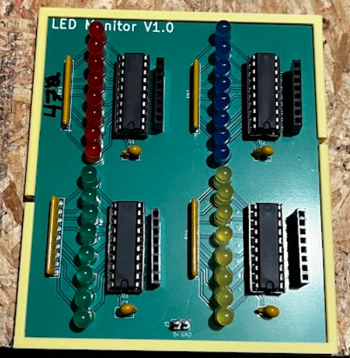

# led_monitor
LED Monitor PCB

### Description

LED Monitor is a PCB with four 8-channel inputs useful for connecting to DATA, ADDRESS, and CONTROL lines for troubleshooting and diagnostics when working with vintage CPUs like the Z80.

### Bill of Materials (BOM)

| Item | Reference | Description | Qty | Notes |
| :--- | :--- | :--- | :--- | :--- |
| **74HCT541** | U1,U2,U3,U4 | Octal Buffer | 4 | Drives the LEDs. |
| **20 Pin Socket** | U1,U2,U3,U4 | IC Socket | 4 | Optional |
| **Resistor Array** | RN1,RN2,RN3,RN4 | 470 $\Omega$ 9pin Resistor Array | 4 | |
| **LEDs** | D1-D32 | 3mm or 5mm Standard LED | 32 | 4 Colors |
| **Decoupling Capacitors** | C1,C2,C3,C4 | 0.1 $\mu\text{F}$ (104) ceramic capacitor | 4 | |
| **Channel Inputs** | J1,J2,J3,J4 | 01x08 Pin Header | 4 | |
| **Power Connector** | J5 | 01x02 Pin Header | 1 | Power Input |

### Usage Notes

Ground and 5V power from your circuit is sufficient to power all 32 LEDs.  Octal Buffer keeps all LEDs lit and manages power draw.  

**NOTE** Any unused channel inputs should be pulled to GND as the 74HCT541 is highly susceptible to rogue input signal interference while pins are floating.  This will cause LEDs to light randomly if your hand or other conductive objects get near them.

### License
This project is licensed under the MIT License.